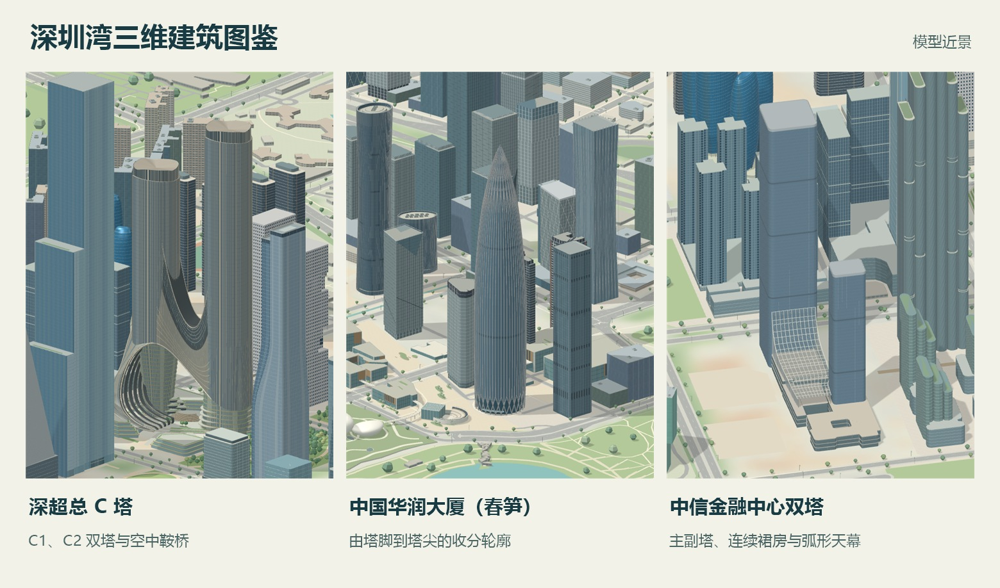

# 深圳湾 3D 建筑图鉴

可离线浏览的深圳湾建筑模型，覆盖后海与深圳湾超级总部基地。可旋转和缩放场景、搜索楼名、切换街区视角，并查看建筑部件的尺寸及依据。



## 打开图鉴

下载到本地后，用支持 WebGL 的浏览器打开 [深圳湾_全景建筑.html](全景建筑版/深圳湾_全景建筑.html)。模型和查看器已内嵌，无需本地服务器。单独的 GLB 模型由 Git LFS 管理，可用于支持 glTF 2.0 的 3D 软件。

```bash
git lfs install
git clone https://github.com/Bofly-007/shenzhen-bay-3d-atlas.git
cd shenzhen-bay-3d-atlas
git lfs pull
```

## 项目文件

- [全景建筑版](全景建筑版/) 提供离线图鉴、GLB、渲染对照图、建筑部件清单、尺寸表和复核记录。建模依据见 [本版依据](全景建筑版/本版依据.md) 和 [图鉴逐项对照与来源](全景建筑版/图鉴逐项对照与来源.md)。
- [viewer](viewer/) 包含 [三维浏览器源码](viewer/main.js) 及打包和检查工具。
- [scripts](scripts/) 包含底图预处理、[场景建模](scripts/build_city.py) 及几何复核脚本。
- [data](data/) 保存部分原始数据和中间数据，以及各街区的资料来源。

用现有 GLB 构建一个基础浏览页：

```bash
npm install --prefix viewer
node viewer/build.cjs "全景建筑版/深圳湾_全景建筑.glb" "dist/深圳湾_基础浏览.html"
```

全景成品是在此前的建筑核尺版上迭代得到的。部分历史脚本依赖那一版的 GLB 和清单，当前仓库无法单独从零重建同一份全景成品。

## 数据与许可

**商业使用须事先取得 Bofly-007 的书面许可。** 本项目公开源码，允许非商业学习、修改和分享。未经许可，不得通过项目原创代码、模型、文档或其衍生版本获取直接或间接商业利益，包括出售、收费交付、用于商业服务、广告变现或商业推广。详见 [非商业使用许可](LICENSE)。

第三方代码、地理数据和素材按各自原有条款使用。详见 [数据来源与署名](NOTICE.md)。

图鉴用于可视化。楼高和轮廓包含估算，部分建筑展示规划方案或示意体量。详见 [本版依据](全景建筑版/本版依据.md)。
